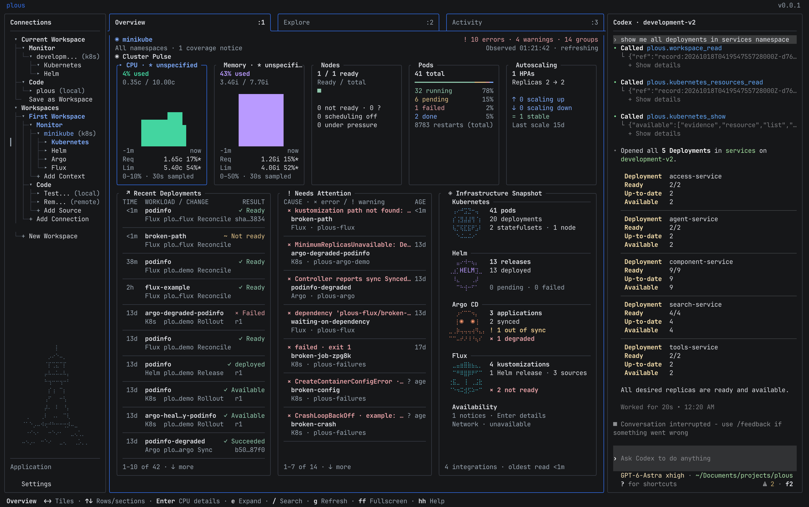

<h1 align="center">
  <a href="assets/logo/lockup.svg#gh-light-mode-only">
    
  </a>
  <a href="assets/logo/lockup-dark.svg#gh-dark-mode-only">
    
  </a>
</h1>

<p align="center">
  <strong>Your Kubernetes journey, in one terminal.</strong>
</p>

<p align="center">
  <a href="#getting-started">Getting started</a> ·
  <a href="docs/README.md">Documentation</a> ·
  <a href="#mcp">MCP</a> ·
  <a href="#contributing">Contributing</a>
</p>

Plous is an open-source Kubernetes operations tool for inspecting clusters and investigating problems with AI. It brings **Kubernetes, Helm, Argo CD, and Flux** into one terminal workspace.

The name comes from Greek **πλοῦς**, meaning voyage. Kubernetes is the helmsman; Plous is the journey.



## Features

- **Cluster operations:** health, resource usage, YAML editing, events, logs, and container terminals.
- **Helm and GitOps:** inspect release revisions, preview changes, roll back, and explore Argo CD and Flux status.
- **AI investigation:** use Plous, Claude Code, or Codex with cluster reads and saved evidence. Explicitly enable container commands or temporary diagnostic tests when needed.
- **Workspaces:** organize cluster contexts, retain revisions, and resume conversations.

AI is optional. See [integration support](docs/integrations/README.md) for capabilities and limits.

## Getting started

Requires macOS or Linux, Homebrew, and an interactive terminal. Source installation is also available.

```sh
brew install simjay/tap/plous
plous
```

Plous opens with your current Kubernetes context. Press **hh** for Help while navigating, or use `:quit` to exit.

Choose your [workflow](docs/getting-started/workflows.md), read [installation requirements](docs/getting-started/installation.md), or follow the [quickstart](docs/getting-started/README.md).

## MCP

Standalone MCP and plous-debug are included starting with v0.0.3. See [Installation](docs/getting-started/installation.md) to install or update.

Plous connects cluster tools to Claude Code or Codex through **Model Context Protocol (MCP)**. Choose where you want to work:

| Workflow | Setup |
| --- | --- |
| Inside the Plous assistant panel | Select your installed agent in **Settings → Application → Agent**. Plous configures the connection automatically. |
| Direct MCP integration | Configure your client to launch `plous mcp serve` with an explicit context. No TUI or skill installation is required. |
| Guided debugging in your coding-agent session | Run `plous setup codex` or `plous setup claude` to install **plous-debug** and register a local stdio MCP server. |

Entry commands default to `claude` and `codex`. Configure each agent's **Entry command** in the same settings to use a wrapper such as `celai codex`.

All workflows use the same guarded cluster tools. The CLI keeps its own authentication and model settings. Agents inside Plous can also open views beside the conversation; independent coding agents keep their normal repository tools.

[MCP server](docs/mcp/README.md) · [Agent skills](docs/agent-skills/README.md) · [plous-debug](docs/agent-skills/plous-debug.md) · [Assistant panel](docs/guides/plous-mcp.md)

## Documentation

- [User guides](docs/README.md)
- [Keymap](docs/reference/keymap.md) and [configuration](docs/reference/configuration.md)
- [Data and privacy](docs/reference/data-and-privacy.md)
- [Troubleshooting](docs/reference/troubleshooting.md)

## Contributing

Bug reports, documentation improvements, and code contributions are welcome. [Open an issue](https://github.com/simjay/plous/issues) or read the [contributor guide](docs/contributing/README.md). Discuss larger changes first.

## License

[Apache-2.0](LICENSE).
