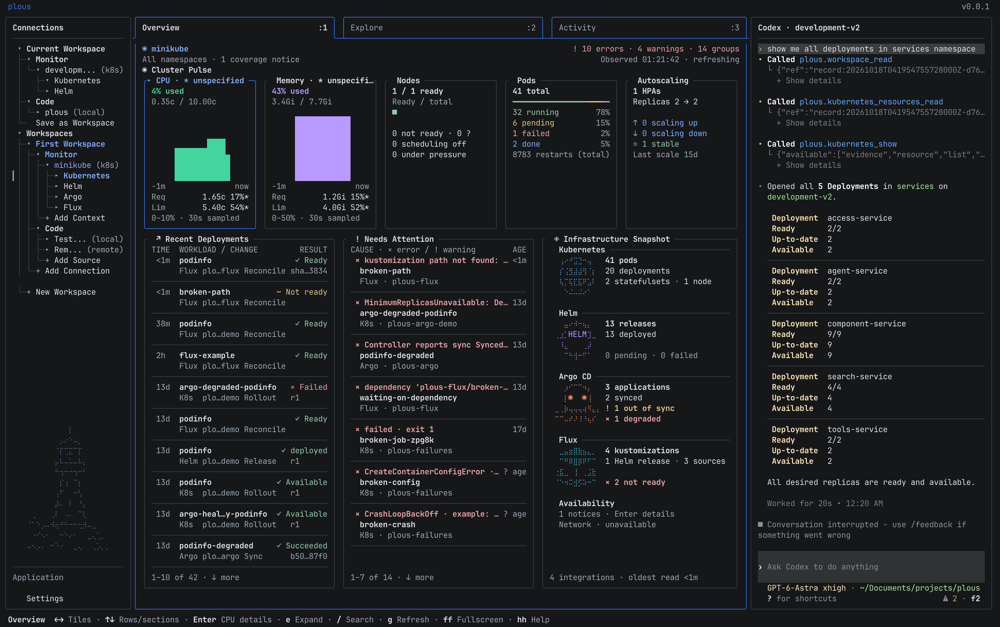

<h1 align="center">
  <a href="assets/logo/lockup.svg#gh-light-mode-only">
    
  </a>
  <a href="assets/logo/lockup-dark.svg#gh-dark-mode-only">
    
  </a>
</h1>

<p align="center">
  <strong>Your Kubernetes journey, in one terminal.</strong>
</p>

<p align="center">
  <a href="#getting-started">Terminal UI</a> ·
  <a href="#coding-agents">Coding agents</a> ·
  <a href="https://simjay.github.io/plous/docs/">Documentation</a> ·
  <a href="#contributing">Contributing</a>
</p>

Plous is an open-source Kubernetes operations tool for inspecting clusters and investigating problems with AI. It brings **Kubernetes, Helm, Argo CD, and Flux** into one terminal workspace.

The name comes from Greek **πλοῦς**, meaning voyage. Kubernetes is the helmsman; Plous is the journey.



## Features

- **Cluster operations:** health, resource usage, YAML editing, events, logs, and container terminals.
- **Helm and GitOps:** inspect release revisions, preview changes, roll back, and explore Argo CD and Flux status.
- **AI investigation:** use Plous, Claude Code, or Codex with cluster reads and saved evidence. Explicitly enable container commands or temporary diagnostic tests when needed.
- **Workspaces:** organize cluster contexts, retain revisions, and resume conversations.

AI is optional. See [integration support](docs/integrations/README.md) for capabilities and limits.

## Getting started

Requires macOS or Linux, Homebrew, and an interactive terminal. Source installation is also available.

```sh
brew install simjay/tap/plous
plous
```

Plous opens with your current Kubernetes context. Press **hh** for Help while navigating, or use `:quit` to exit.

Follow the [terminal UI quickstart](docs/getting-started/README.md) or [set up the AI assistant](docs/guides/ai-chat.md).

<a name="mcp"></a>

## Coding agents

Use **plous-debug** in the coding agent you run in your repository. It gives your agent a workflow for investigating Kubernetes failures and connects the cluster tools it needs to check its findings.

Run `plous setup` to list the supported clients. Pick your agent in the [setup guide](docs/agent-skills/plous-debug.md#install) to install the skill and connect its tools.

## Documentation

- [User guides](docs/README.md)
- [Keyboard shortcuts and commands](docs/reference/keymap.md) and [configuration](docs/reference/configuration.md)
- [Data and privacy](docs/reference/data-and-privacy.md)
- [Troubleshooting](docs/reference/troubleshooting.md)

## Contributing

Bug reports, documentation improvements, and code contributions are welcome. [Open an issue](https://github.com/simjay/plous/issues) or read the [contributor guide](docs/contributing/README.md). Discuss larger changes first.

## License

[Apache-2.0](LICENSE).
