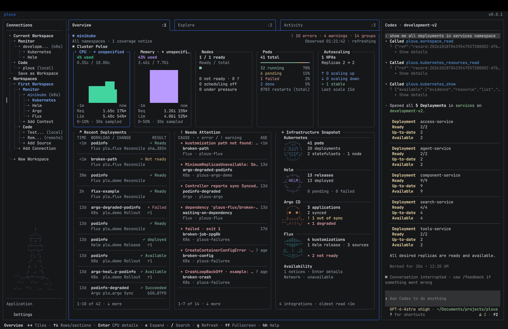

<h1 align="center">
  <picture>
    <source media="(prefers-color-scheme: dark)" srcset="assets/logo/lockup-dark.svg">
    <source media="(prefers-color-scheme: light)" srcset="assets/logo/lockup.svg">
    
  </picture>
</h1>

<p align="center">
  <strong>Your Kubernetes journey, in one terminal.</strong>
</p>

<p align="center">
  <a href="#getting-started">Getting started</a> ·
  <a href="docs/README.md">Documentation</a> ·
  <a href="#mcp">MCP</a> ·
  <a href="#contributing">Contributing</a>
</p>

Plous is an open-source Kubernetes lifecycle tool for inspecting clusters, working with configuration, and investigating problems with AI. It brings **Kubernetes, Helm, Kustomize, Argo CD, and Flux** into one terminal workspace.

The name comes from Greek **πλοῦς**, meaning voyage. Kubernetes is the helmsman; Plous is the journey.



## Features

- **Cluster operations:** health, resource usage, YAML editing, events, logs, and container terminals.
- **Configuration:** browse local files, render Helm charts and Kustomize overlays, and compare output.
- **Helm and GitOps:** inspect release revisions, preview changes, roll back, and explore Argo CD and Flux status.
- **AI investigation:** use OpenAI or Anthropic through Plous, or your installed Claude Code or Codex, with read-only tools and saved evidence.
- **Workspaces:** organize contexts and repositories, retain revisions, and resume conversations.

AI is optional. Configuration workflows work without a cluster. See [integration support](docs/integrations/README.md) for capabilities and limits.

## Getting started

Requires macOS or Linux, **Go 1.26.4+**, Git, Make, and an interactive terminal.

```sh
git clone https://github.com/simjay/plous.git
cd plous
make run
```

Plous opens with your current Kubernetes context and working directory. Press **hh** for Help while navigating, or use `:quit` to exit.

See [Getting started](docs/getting-started/README.md) for installation, requirements, and first steps.

## MCP

Plous connects its tools to Claude Code or Codex through **Model Context Protocol (MCP)**. Select your installed agent in **Settings → Application → Agent**; setup is automatic, and the CLI keeps its own authentication and model settings.

Agents can inspect the selected cluster or source, search saved evidence, and open relevant views beside the conversation. The bridge runs within the native agent session; there is no standalone MCP server.

[Setup and examples](docs/guides/plous-mcp.md) · [Tool reference](docs/reference/mcp.md)

## Documentation

- [User guides](docs/README.md)
- [Keymap](docs/reference/keymap.md) and [configuration](docs/reference/configuration.md)
- [Data and privacy](docs/reference/data-and-privacy.md)
- [Troubleshooting](docs/reference/troubleshooting.md)

## Contributing

Bug reports, documentation improvements, and code contributions are welcome. [Open an issue](https://github.com/simjay/plous/issues) or read the [contributor guide](docs/contributing/README.md). Discuss larger changes first.

## License

[Apache-2.0](LICENSE).
